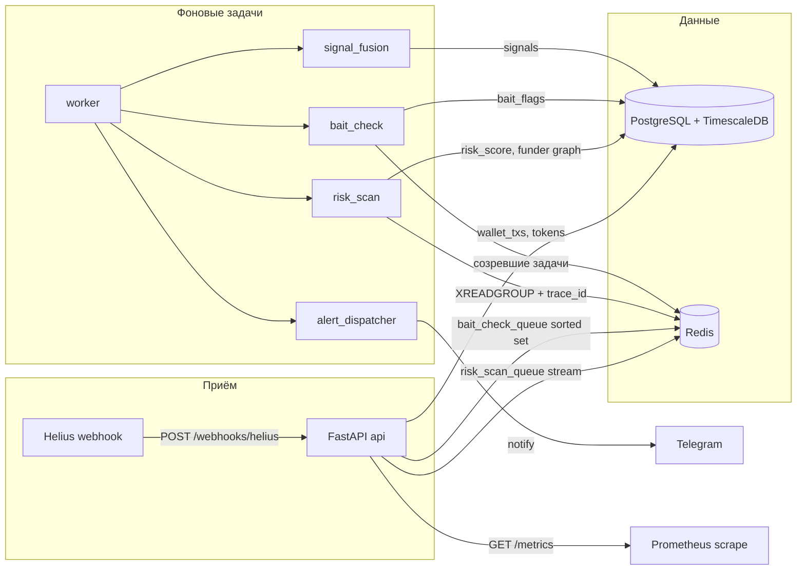

# SignalForge

Инструмент мониторинга мемкоинов на Solana. Интерфейс — Telegram-бот: `/start` открыт для всех, сигналы уходят каждому подписчику. Команды кошельков (`/watch`, `/unwatch`, `/wallets`) доступны только `role=admin`. Id из `TELEGRAM_ADMIN_IDS` получают эту роль при создании записи. Публичной страницы и канала нет.

**Это не финансовый совет.** Балл риска описывает известные ончейн-паттерны и не доказывает, что токен безопасен или опасен. Текущая версия не хранит приватные ключи пользователей и не отправляет сделки, swap или любые транзакции от их имени.

Источник запретов и стека: [`AGENTS.md`](AGENTS.md).

## Как устроено



Один buy получает `trace_id`. Он пишется в сообщение `risk_scan_queue`, затем в `tokens.trace_id` и `signals.trace_id`. Логи `webhook_handled`, `risk_scan_stored`, `signal_created` и `alert_sent` содержат это поле, так что одну покупку видно через весь путь.

## Локальный запуск

1. `cp .env.example .env`
2. `docker compose up --build`
3. `curl localhost:8000/health` → `{"status":"ok","db":"connected","redis":"connected"}`

Compose для разработки сам подставляет `DATABASE_URL` и `REDIS_URL`. Плейсхолдер `replace-me` не включает Telegram polling и публичный API (ответ 503, пока не задан настоящий ключ).

Миграции:

```bash
docker compose up -d postgres
uv run alembic upgrade head
```

Образ Postgres: `timescale/timescaledb:2.30.1-pg16-oss`.

Откат ревизии `0015` — в разделе «Откат ревизии 0015» ниже. Сначала останавливается worker, потом удаляется ключ Redis, и только затем `alembic downgrade`.

## Как создать Helius webhook вручную перед первым запуском

Бот webhook не создаёт. Один раз его заводит человек в кабинете, дальше `/watch` только дописывает адрес в `accountAddresses` через `PUT /v0/webhooks/{id}`.

1. Откройте [Helius Dashboard → Webhooks](https://dashboard.helius.dev/webhooks) под ключом из `HELIUS_API_KEY`.
2. Create Webhook. Network: **Mainnet**.
3. Webhook type: **Enhanced** (`enhanced`, не `enhancedDevnet`).
4. Transaction types: **SWAP** и **TRANSFER**.
5. Webhook URL: публичный `https://<ваш-хост>/webhooks/helius`. Локальный `localhost` Helius не вызовет.
6. Authentication header: та же строка, что `HELIUS_WEBHOOK_SECRET`. Helius присылает её в `Authorization`, и API сравнивает значение целиком.
7. Account addresses можно оставить пустым. Адреса добавит `/watch`.
8. Сохраните webhook и скопируйте его id в `HELIUS_WEBHOOK_ID`.
9. Перезапустите worker. Пока id пустой, `/watch` отвечает, что webhook не задан, и строку в базу не пишет.

Документация метода: [Webhooks API](https://www.helius.dev/docs/api-reference/webhooks/llms.txt). Обновление адреса читает текущий webhook и отправляет обратно `webhookURL`, `webhookType`, `transactionTypes` и новый `accountAddresses`, чтобы PUT не стёр тип событий.

## Деплой

Продакшен-файл не монтирует код. API и worker используют один собранный образ `signalforge:prod`. У каждого сервиса есть healthcheck, `restart: unless-stopped` и лимит CPU/памяти. Postgres и Redis наружу не публикуются.

```bash
export POSTGRES_USER=signalforge
export POSTGRES_PASSWORD='…'
export POSTGRES_DB=signalforge
export HELIUS_API_KEY='…'
export HELIUS_WEBHOOK_SECRET='…'
export TELEGRAM_BOT_TOKEN='…'
export PUBLIC_API_KEY='…'
docker compose -f docker-compose.prod.yml up -d --build
docker compose -f docker-compose.prod.yml exec api alembic upgrade head
```

Проверка: `curl localhost:8000/health` и `curl localhost:8000/metrics`.

## Откат ревизии 0015

Снимки `+1h`, `+24h` и `+7d` лежат в Redis-ключе `signalforge:outcome:pending`. Его пишет и читает процесс `worker` (`python -m app.workers.runner`), не миграция. Пока worker запущен, созревший горизонт он записывает в `outcome_checks`.

`alembic downgrade` эту таблицу удаляет и ключ не трогает. Если worker в этот момент ещё работает, запись результата падает: таблицы уже нет, член остаётся в наборе и крутится на каждом опросе. Уже снятые цены при откате схемы тоже уходят вместе с таблицей.

Порядок такой. Не менять его местами.

```bash
docker compose -f docker-compose.prod.yml stop worker
docker compose -f docker-compose.prod.yml exec redis redis-cli DEL signalforge:outcome:pending
docker compose -f docker-compose.prod.yml exec api alembic downgrade 0014_funder_cache_signature
```

`0014_funder_cache_signature` — родитель ревизии `0015`, не «какая-то предыдущая». Команда откатывает схему ровно до неё. Она верна, только пока голова — `0015`. Если позже появится `0016` или ещё одна ревизия, эту команду не копировать: она снимет и всё, что накатили после `0015`. Раздел нужно переписать под фактическую голову.

`DEL` по ключу, которого ещё нет, завершается без ошибки и печатает `0`. Так и должно быть, если откат случился до первого пула и набор не создавался. `0` не повод останавливать процедуру.

Локально то же самое: `docker compose stop worker`, затем `docker compose exec redis redis-cli DEL signalforge:outcome:pending`, затем `uv run alembic downgrade 0014_funder_cache_signature`.

После этого не поднимать текущий worker на откатанной схеме. Сначала образ без этой ревизии, потом `docker compose -f docker-compose.prod.yml start worker`.

Сейчас это держится на том, что раздел прочитан целиком. Проверки ревизии при старте worker нет: процесс не сверяет `alembic_version` с ревизией, под которую собран образ. Такая проверка отказала бы в старте на несовместимой схеме. Её нет, это следующий шаг, если процедуру захочется закрыть не только текстом.

Перед первым запуском на живых пользователях нужен платный ключ Helius (`funded-by` на бесплатном плане отвечает 403), секрет webhook, токен бота из BotFather и `PUBLIC_API_KEY`, отличный от `replace-me`.

## Переменные окружения

| Переменная | Зачем |
| --- | --- |
| `DATABASE_URL` | `postgresql+asyncpg://…` |
| `REDIS_URL` | `redis://` или `rediss://` |
| `HELIUS_API_KEY` | Ключ Helius. В URL не класть. |
| `HELIUS_WEBHOOK_SECRET` | Полное значение заголовка `Authorization`, которое Helius повторяет из `authHeader`. |
| `HELIUS_WEBHOOK_ID` | Id webhook, созданного один раз в Helius Dashboard. Пусто — `/watch` не сохраняет кошелёк. |
| `HELIUS_API_BASE_URL` | По умолчанию `https://api.helius.xyz`. |
| `HELIUS_RPC_URL` | По умолчанию `https://mainnet.helius-rpc.com`. |
| `RAYDIUM_API_BASE_URL` | По умолчанию `https://api-v3.raydium.io`. |
| `TELEGRAM_BOT_TOKEN` | Токен BotFather. Пусто или `replace-me` — бот не стартует. |
| `TELEGRAM_ADMIN_IDS` | Числовые Telegram id через запятую. Эти id получают `role=admin` при `/start`. Пусто — админов нет, регистрация и алерты остаются. |
| `PUBLIC_API_KEY` | Секрет заголовка `X-API-Key`. Пусто или `replace-me` — публичное API отвечает 503. |
| `API_RATE_LIMIT_PER_MINUTE` | Лимит на один ключ. По умолчанию 60. |
| `ANTHROPIC_API_KEY` | Зарезервировано, в MVP не вызывается. |
| `TWITTER_BEARER_TOKEN` | Зарезервировано, модуля Twitter нет. |
| `GROQ_API_KEY` | Ключ Groq для AI review. Пусто — живые вызовы выключены. |
| `AI_REVIEW_MODEL` | Id модели Groq. По умолчанию `openai/gpt-oss-120b`. |
| `ENVIRONMENT` | `dev` или `prod`. |
| `LOG_LEVEL` | `DEBUG`, `INFO`, `WARNING`, `ERROR`, `CRITICAL`. |

Секреты только в окружении или локальном `.env`. `.env` не коммитится.

## API

- `POST /webhooks/helius` — приём Helius, без `X-API-Key`.
- `GET /health` — Postgres и Redis.
- `GET /metrics` — Prometheus: обработанные webhook, отправленные алерты, латентность risk scan, размер `risk_scan_queue` и `bait_check_queue`.
- `/docs` — публичное API: watchlist, сигналы, риск токена, настройки пользователя. Заголовок `X-API-Key`.

## Проверки

```bash
uv sync --group dev
uv run ruff check app tests
uv run mypy --strict app/services app/adapters
uv run pytest --cov=app/services --cov-report=term-missing --cov-fail-under=70
```

CI: [`.github/workflows/ci.yml`](.github/workflows/ci.yml) на `push` и `pull_request`. Перед коммитом gitleaks ставится через [`.pre-commit-config.yaml`](.pre-commit-config.yaml):

```bash
pip install pre-commit
pre-commit install
pre-commit run --all-files
```

`tests/test_models.py` нужен Postgres с TimescaleDB на `localhost:5432`. Остальные интеграционные тесты поднимают Timescale и Redis через testcontainers.

## Модель Groq

Ревью по умолчанию идёт в `openai/gpt-oss-120b` (`AI_REVIEW_MODEL`). Groq регулярно снимает модели с эксплуатации и предупреждает примерно за 60 дней. Это повторяющийся тип отказа этого провайдера, не разовый случай: перед живым прогоном стоит сверяться с [deprecations](https://console.groq.com/docs/deprecations). Смена id — через `AI_REVIEW_MODEL`, без правки кода. Опубликованный free-tier ряд этой модели (30 RPM, 1 000 RPD, 8 000 TPM, 200 000 TPD) лежит на [rate limits](https://console.groq.com/docs/rate-limits); точные цифры организации — на странице Limits в кабинете.

## Вне этой версии

Исполнение сделок и модуль Twitter не реализованы и не должны появляться без отдельного решения. Авто-отправка транзакций от имени пользователя запрещена.
