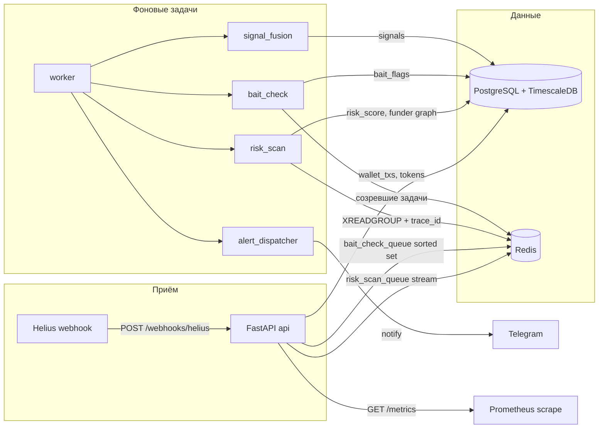

# SignalForge

Сервис мониторинга и риск-анализа мемкоинов на Solana. Он принимает webhook Helius по отслеживаемым кошелькам, считает технический риск токена, ищет эвристики copy-trade bait и рассылает сигнал в Telegram тем, кто подписался.

**Это не финансовый совет.** Балл риска описывает известные ончейн-паттерны и не доказывает, что токен безопасен или опасен. Текущая версия не хранит приватные ключи пользователей и не отправляет сделки, swap или любые транзакции от их имени.

Источник запретов и стека: [`AGENTS.md`](AGENTS.md).

## Как устроено



Один buy получает `trace_id`. Он пишется в сообщение `risk_scan_queue`, затем в `tokens.trace_id` и `signals.trace_id`. Логи `webhook_handled`, `risk_scan_stored`, `signal_created` и `alert_sent` содержат это поле, так что одну покупку видно через весь путь.

## Локальный запуск

1. `cp .env.example .env`
2. `docker compose up --build`
3. `curl localhost:8000/health` → `{"status":"ok","db":"connected","redis":"connected"}`

Compose для разработки сам подставляет `DATABASE_URL` и `REDIS_URL`. Плейсхолдер `replace-me` не включает Telegram polling и публичный API (ответ 503, пока не задан настоящий ключ).

Миграции:

```bash
docker compose up -d postgres
uv run alembic upgrade head
```

Образ Postgres: `timescale/timescaledb:2.30.1-pg16-oss`.

## Деплой

Продакшен-файл не монтирует код. API и worker используют один собранный образ `signalforge:prod`. У каждого сервиса есть healthcheck, `restart: unless-stopped` и лимит CPU/памяти. Postgres и Redis наружу не публикуются.

```bash
export POSTGRES_USER=signalforge
export POSTGRES_PASSWORD='…'
export POSTGRES_DB=signalforge
export HELIUS_API_KEY='…'
export HELIUS_WEBHOOK_SECRET='…'
export TELEGRAM_BOT_TOKEN='…'
export PUBLIC_API_KEY='…'
docker compose -f docker-compose.prod.yml up -d --build
docker compose -f docker-compose.prod.yml exec api alembic upgrade head
```

Проверка: `curl localhost:8000/health` и `curl localhost:8000/metrics`.

Перед первым запуском на живых пользователях нужен платный ключ Helius (`funded-by` на бесплатном плане отвечает 403), секрет webhook, токен бота из BotFather и `PUBLIC_API_KEY`, отличный от `replace-me`.

## Переменные окружения

| Переменная | Зачем |
| --- | --- |
| `DATABASE_URL` | `postgresql+asyncpg://…` |
| `REDIS_URL` | `redis://` или `rediss://` |
| `HELIUS_API_KEY` | Ключ Helius. В URL не класть. |
| `HELIUS_WEBHOOK_SECRET` | Полное значение заголовка `Authorization`, которое Helius повторяет из `authHeader`. |
| `HELIUS_API_BASE_URL` | По умолчанию `https://api.helius.xyz`. |
| `HELIUS_RPC_URL` | По умолчанию `https://mainnet.helius-rpc.com`. |
| `RAYDIUM_API_BASE_URL` | По умолчанию `https://api-v3.raydium.io`. |
| `TELEGRAM_BOT_TOKEN` | Токен BotFather. Пусто или `replace-me` — бот не стартует. |
| `PUBLIC_API_KEY` | Секрет заголовка `X-API-Key`. Пусто или `replace-me` — публичное API отвечает 503. |
| `API_RATE_LIMIT_PER_MINUTE` | Лимит на один ключ. По умолчанию 60. |
| `ANTHROPIC_API_KEY` | Зарезервировано, в MVP не вызывается. |
| `TWITTER_BEARER_TOKEN` | Зарезервировано, модуля Twitter нет. |
| `ENVIRONMENT` | `dev` или `prod`. |
| `LOG_LEVEL` | `DEBUG`, `INFO`, `WARNING`, `ERROR`, `CRITICAL`. |

Секреты только в окружении или локальном `.env`. `.env` не коммитится.

## API

- `POST /webhooks/helius` — приём Helius, без `X-API-Key`.
- `GET /health` — Postgres и Redis.
- `GET /metrics` — Prometheus: обработанные webhook, отправленные алерты, латентность risk scan, размер `risk_scan_queue` и `bait_check_queue`.
- `/docs` — публичное API: watchlist, сигналы, риск токена, настройки пользователя. Заголовок `X-API-Key`.

## Проверки

```bash
uv sync --group dev
uv run ruff check app tests
uv run mypy --strict app/services app/adapters
uv run pytest --cov=app/services --cov-report=term-missing --cov-fail-under=70
```

CI: [`.github/workflows/ci.yml`](.github/workflows/ci.yml) на `push` и `pull_request`. Перед коммитом gitleaks ставится через [`.pre-commit-config.yaml`](.pre-commit-config.yaml):

```bash
pip install pre-commit
pre-commit install
pre-commit run --all-files
```

`tests/test_models.py` нужен Postgres с TimescaleDB на `localhost:5432`. Остальные интеграционные тесты поднимают Timescale и Redis через testcontainers.

## Вне этой версии

Исполнение сделок и модуль Twitter не реализованы и не должны появляться без отдельного решения. Авто-отправка транзакций от имени пользователя запрещена.
