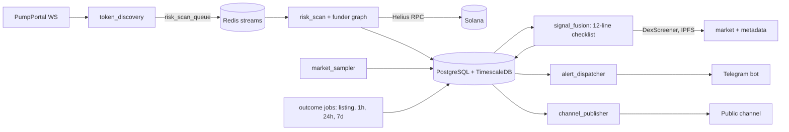

# SignalForge

A Telegram bot that watched every new Solana memecoin on pump.fun, ran a
12-line on-chain safety checklist on each token that migrated to a DEX, and
posted every signal to a public channel with its 1h, 24h, and 7d results, losses
included.

It ran live for about a day. Then I backtested it: **the safety checks filter
out obvious scams, but they do not predict whether a token survives, and the
signals had no trading edge.** The project is closed. The numbers are in
[Results](#results).

Not financial advice. The bot never held private keys and never sent a
transaction.

## What it does

1. **Discovery.** A PumpPortal WebSocket streams every new token and every
   migration from the pump.fun bonding curve to PumpSwap (~18,000 launches a day).
2. **Risk scan** (Helius RPC): mint and freeze authority, LP burn share,
   Token-2022 extensions, top-10 holder share, and a funder graph. The funder
   graph walks each top holder's first funding transfer to find wallets paid
   from one source, and measures how much supply the creator's cluster holds.
3. **Checklist.** 12 lines, each pass, fail, or no data. No data never counts
   as a pass. A signal needs 4 required lines plus at least 9 of 12. Market
   lines (liquidity, 5-minute buys vs sells) come from DexScreener. Socials
   come from the token's IPFS metadata. Launch trades are counted from the
   bonding curve's earliest signatures.
4. **Delivery.** A signal card goes to subscribers in Telegram, with an
   optional AI note (Groq) that only restates the checklist.
5. **Public track record.** Each signal is posted to a channel at the moment
   it fires, so Telegram's timestamp is the proof. Results follow as replies
   with an ASCII market-cap chart. A result without a reading in time is
   marked skipped, never filled in.

Signal card in the bot (illustrative values). Each token gets an ASCII mascot
chosen from a hash of its mint:

```
 [o_o]    MCap  $51.7k
 /|_|\    Liq   $17.8k
  d b     5m    66 buy/10 sell

Safety   ▰▰▰▰▰▰▰▰▰▱▱▱ 9/12

Contract ████ 4/4
 ✓ Mint revoked
 ✓ Freeze revoked
 ✓ LP burned ≥95%
 ✓ No fee/hook/delegate

Holders  ██░░ 2/4
 ✗ Top-10 >50%
 ✓ No funder cluster
 ✓ Creator 5% (≤30%)
 ✗ Launch trades 8 (≤3)

Market   ███░ 3/4
 ✓ Liq $17.8k (≥$10k)
 ✓ 5m 66 buy/10 sell
 ✗ Ticker clones: 2
 ✓ Socials (unverified)
```

Result reply in the channel (example rendering):

```
  $120k┤    ███
       │  ▂▂███▅▅▅
       │▁▁████████
       │██████████▅▅▅▅▅
  $3.6k┤███████████████▂▂▂▂▁
       └────────────────────
        0m      30m      60m
```

## Architecture



One worker process runs all loops under asyncio. External calls go only
through `app/adapters`. Every token carries a `trace_id` from discovery to the
alert, so one token can be followed through the logs.

Built to run on free tiers: Helius free RPC (10 RPS, 1M credits/month) is the
binding limit. A Redis daily request budget and a scan funnel brought RPC
spend from ~345 to ~2 requests a minute.

## Stack

Python 3.12 · asyncio · FastAPI · SQLAlchemy 2 (async) + Alembic ·
PostgreSQL 16 + TimescaleDB · Redis streams · python-telegram-bot · httpx ·
Docker Compose · pytest + testcontainers (343 tests) · ruff · mypy · structlog ·
Prometheus metrics

## Results

Data from 2026-10-15 to 2026-10-16. The backtest code is not in the
repository; it read the stored scans and current DexScreener prices.

**Base rate.** Of 217 scanned tokens that migrated, 88% were dead a day later
(market cap under $15k or liquidity under $3k). The median market cap was
about $1.9k.

**Death rate by check** (dead when the line passed vs. when it failed):

| Check | Passed | Failed |
|---|---|---|
| Top-10 holder share | 90% (n=70) | 88% (n=147) |
| Creator share ≤30% | 88% (n=43) | 83% (n=70) |
| Funder cluster | 87% (n=185) | 94% (n=18) |
| LP burned | 88% (n=203) | 100% (n=12) |
| Unique ticker | 84% (n=81) | 89–97% |
| Signalled by the bot | 85% (n=39) | 89% (rest) |
| **1h price ≥ listing price** | **55% (n=11)** | **92% (n=65)** |

**Signals.** The 17 signals with a 1h result had a median change of −67% at
1h. 7 lost 90% or more, and 1 doubled. A simulated exit at +30% take-profit or
−20% stop-loss on 12 checklist signals averaged −1.7% per trade, before fees
and slippage.

**What I learned**

- The safety checks catch blunt scams such as a live mint authority or
  unburned LP. Soft rugs pass all 12 lines.
- Momentum after an hour was the only signal with any strength, and 11 tokens
  are too few to rely on it.
- Relaxing a filter that showed no predictive power still made the signals
  worse. Making the creator-share line optional let celebrity-name tickers
  through. Backtests on one outcome measure miss what a filter does
  indirectly.
- On a free RPC tier, the creator share could be measured for only 13% of
  tokens. A required check with that much missing data mostly throttles the
  signal flow.

## Running it

Operations notes in Russian (setup, deploy, Helius webhook, budgets,
migration rollback): [`docs/operations.ru.md`](docs/operations.ru.md).

```bash
cp .env.example .env        # fill in the keys
docker compose up -d --build
uv run alembic upgrade head
uv run pytest -q            # needs Docker for testcontainers
```

Project rules (fixed stack, no private keys, no trade execution):
[`AGENTS.md`](AGENTS.md).
